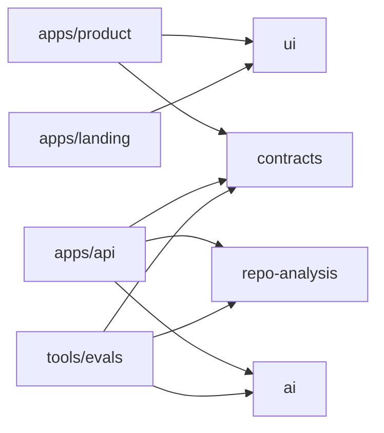
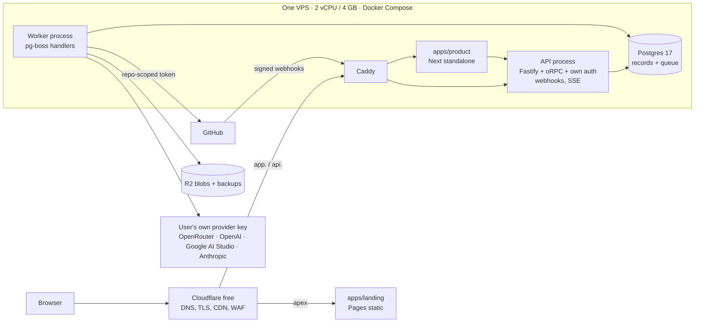

# ARCHITECTURE.md

How Replo fits together. Requirements live in [`PRD.md`](./PRD.md); research and alternatives in [`Replo_BluePrint.md`](./Replo_BluePrint.md) (§4–§14, §17).

## 1. Shape

**Modular monolith with separate API and worker processes**, three apps, five shared packages, one eval tool. One language (TypeScript), one deploy unit for the backend.

```
replo/
├── apps/
│   ├── landing/    Next.js 16 — static export (Cloudflare Pages): marketing, key guide, docs
│   ├── product/    Next.js 16 — the app, learning player, public tutorial pages (SSR)
│   └── api/        Fastify 5 + oRPC + own auth — entrypoints: main.http.ts, main.worker.ts
├── packages/
│   ├── contracts/      Zod 4 schemas + oRPC contract + error codes + tutorial content schema
│   ├── ai/             AI SDK wrapper, role→model registry, budgets, provider resolution
│   ├── repo-analysis/  filters, path safety, (later) tree-sitter, symbols, import graph, chunking
│   ├── ui/             Base UI primitives, Tailwind v4 tokens, globals.css
│   └── config/         tsconfig bases, ESLint flat config (incl. boundary rules)
└── tools/evals/        golden-repo suite, grounding/cost reports (private workspace package)
```

### Dependency graph (enforced in lint)



Nothing imports an app. `contracts`, `ui`, `ai`, `repo-analysis`, `config` import no other internal package. Frontends never see `ai`, `repo-analysis` or `apps/api`.

## 2. Runtime topology



Only the **worker** talks to GitHub for content, model providers and R2. The product app talks only to the API.

### Memory budget on 4 GB (+2 GB swap)

Postgres ~0.6–1.0 · worker 0.5–1.5 peak (concurrency 1–2) · product ~0.25 · api ~0.2 · Caddy+OS ~0.35. Per-job repo caps keep peaks bounded.

## 3. Backend layout (`apps/api/src`)

```
main.http.ts        Fastify + oRPC router + auth routes + webhooks + SSE + /healthz /readyz
main.worker.ts      pg-boss workers + reaper; only HTTP is /healthz
platform/           config(env), db, queue, storage, logger, crypto (key vault), errors, context
modules/
  identity/         sign-up and sign-in, OAuth (Google, GitHub), sessions, current user
  github/           app installs, token minting, webhooks, access checks
  repositories/     repos, snapshots, pre-flight, cost estimate
  indexing/         orchestrates packages/repo-analysis, stores the index
  generation/       pipeline stages, budgets, prompts via packages/ai
  models/           BYOK keys, model catalogue, presets
  tutorials/        versions, content, publishing, visibility, share links
  learning/         progress, quiz attempts
jobs/registry.ts    job name → handler + payload schema + retry policy
```

Per module: `*.service.ts` (public API) · `*.router.ts` (implements its contract slice) · `*.repo.ts` (private data access). **Modules call each other only through services.**

## 4. Contract-first API

`packages/contracts` defines inputs, outputs and typed errors. The API **implements** the contract (`implement(contract)`); the product app imports only the contract **type** (`ContractRouterClient<typeof contract>`) and builds a TanStack Query client from it. OpenAPI can be emitted from the same contract for a future public API.

```
packages/contracts ──type──▶ apps/product (client)
        └──────runtime────▶ apps/api (router implements contract; Zod validates in/out)
```

## 5. Generation pipeline

| #   | Stage                          | Kind                                    | Model tier | Output                                      |
| --- | ------------------------------ | --------------------------------------- | ---------- | ------------------------------------------- |
| 0   | Pre-flight                     | Deterministic                           | —          | accept/refuse + estimate                    |
| 1   | Ingest                         | Deterministic                           | —          | files on disk, `snapshot_files`             |
| 2   | Static index                   | Deterministic                           | —          | symbols, edges, routes, stack profile       |
| 3   | File summaries (central files) | LLM                                     | small      | `FileSummary[]` cached by blob SHA          |
| 4   | Architecture model             | LLM + checks                            | strong     | `ArchitectureModel` with evidence           |
| 5   | Outline                        | LLM + checks                            | strong     | `Outline` (chapters, objectives, prereqs)   |
| 6   | Context packing                | Deterministic                           | —          | token-budgeted excerpts per chapter         |
| 7   | Lessons + quiz                 | LLM, bounded read-only tools            | mid        | chapter blocks with claim→evidence links    |
| 8   | Diagrams                       | Deterministic (structure) + LLM (flows) | mid        | Mermaid + node→symbol map                   |
| 9   | Validation & repair            | Deterministic + LLM judge sample        | small/mid  | validation report; ≤ 1 repair               |
| 10  | Publish                        | Deterministic, one transaction          | —          | `tutorial_versions`, `tutorial_source_refs` |

`STAGES` in code: `ingest, index, summaries, architecture, outline, lessons, validate, publish`. Critical path 2 → 4 → 5. Parallel: 3 and 7–9 under per-job concurrency cap. **Lite pipeline** (presets `free` and `budget`) merges 4+5, skips LLM summaries, ≤ 5 chapters.

### Grounding — "the model points, the system quotes"

The validator resolves `symbolKey`/anchor quotes to `(path, startLine, endLine, blobSha)` and inserts the excerpt; fabricated identifiers, nonexistent flow hops, stack contradictions, bad diagrams and unsafe Markdown are caught deterministically. Observed claims need ≥ 1 verified ref. Details: PRD §4.5, blueprint §8.3.

## 6. Jobs, queue and reliability

- `generation_jobs` is the durable truth; **pg-boss only delivers work** (at-least-once). Enqueue in the **same transaction** as the job row (no dual-write).
- States: `queued → running → succeeded | failed | canceled`, with `waiting_retry`, `stalled`, `canceling` transitional.
- Claim = conditional update (`queued|waiting_retry|stalled → running`); anything else is a no-op (duplicate delivery).
- Heartbeat every ~15 s; reaper every minute marks stale `running` jobs `stalled` and re-sends them; completed stages are skipped on resume.
- One `AbortSignal` threads into every LLM and HTTP call; cancel flips `canceling`, the heartbeat observes it and aborts. No platform quota is involved (ADR-007).
- Errors classified retryable (429/5xx/overloaded/timeouts) vs terminal (access revoked, too large, budget exceeded, invalid input); backoff with jitter; `retry-after` respected.
- One active job per user, so one user's key is not hit by parallel runs. Queue priority is flat: every job runs on a user's own key.
- **Triggers to add Redis/BullMQ or durable execution:** queue latency above SLO, polling load visible in DB CPU, need for distributed rate limiting, multi-step workflows with long waits.

### Progress delivery

SSE at `GET /jobs/:id/events`. Event `id = job_events.id`; reconnect replays via `Last-Event-ID`; API polls new rows ~1/s per stream (or `LISTEN/NOTIFY` on a direct connection); comment heartbeat every ~15 s; client falls back to TanStack Query polling.

## 7. Keys and model resolution

`packages/ai` exposes **roles**, not vendors. `modelFor({ provider, decryptedKey }, modelId)` picks the client for a job:

| Provider | Client |
| --- | --- |
| `openrouter` (recommended) | OpenRouter with the user's key. `:free` models cost the user nothing |
| `openai` | OpenAI SDK with the user's key |
| `google` | Google AI Studio (Gemini API) with the user's key |
| `anthropic` | Anthropic SDK with the user's key |

Base URLs are fixed per provider. There are no platform-owned keys, so a failing key fails the job and is never swapped for another (PRD FR-RUN-4, ADR-007).

Every call: `budget.reserve → generate → budget.settle` (writes `llm_calls`, updates `spent_micros`). Fallback models only for retryable provider errors, and only models that passed evals.

## 8. Repository ingestion and code understanding

GitHub App (Contents + Metadata, read-only) → resolve ref to SHA → Git Trees pre-flight → one tarball per SHA → safe extraction on a `noexec` volume → deterministic index: inventory → manifests → tree-sitter (WASM) parse → module resolution → framework adapters (Next.js, React Router, Express/Fastify/Hono, stores, API call sites) → entry points → tests → docs → graph analytics → cached summaries (by blob SHA). **Dependencies are never installed.** Retrieval = graph expansion + lexical (BM25/trigram) + model-guided selection; embeddings are deferred (ADR-003).

## 9. Data

Postgres 17 is the system of record (+ queue). Immutable, schema-versioned JSONB tutorial documents + normalised refs/progress. Blobs addressed by git blob SHA in R2. See [`docs/DATABASE.md`](./docs/DATABASE.md).

## 10. Security architecture (summary)

Least-privilege read-only GitHub access · strict per-user scoping with cross-user CI tests · repo content is data not instructions · read-only snapshot-scoped model tools · schema-validated model output + system-inserted excerpts · envelope-encrypted BYOK keys decrypted only in the worker · non-root, read-only-FS, egress-allow-listed worker · strict CSP + allow-list Markdown. Full threat model: [`SECURITY.md`](./SECURITY.md).

## 11. Deployment and environments

| Environment | Where                                                             | Notes                                                  |
| ----------- | ----------------------------------------------------------------- | ------------------------------------------------------ |
| Local       | `docker compose` for Postgres/MinIO + `pnpm dev` on host          | Your own key (OpenRouter recommended)                            |
| Staging     | Same VPS, separate Compose project, DB and GitHub App, basic auth | Skip until real users                                  |
| Production  | The VPS                                                           | Nightly encrypted backups to R2, monthly restore drill |

CI/CD: PR → install frozen → `turbo run lint typecheck test build --affected` → migration drift → eval smoke (recorded fixtures). Main → build images (arm64 if Arm VPS) → GHCR → SSH deploy (`compose pull && run --rm migrate && up -d`). Landing → Cloudflare Pages on push. Nightly → eval suite on free-model allow-list + one paid preset.

Observability: pino JSON → stdout (rotated), Sentry free tier, admin dashboard page reading job and LLM-call tables, scheduled alerts (failure rate > 20%/h, oldest queued > 15 min, disk > 80%, backup failed, key-validation failure spike).

## 12. When to split further

Indexing CPU/memory starves generation workers · a non-TS analyzer is required · a module needs a separate security boundary (code execution, single-tenant) · teams block each other's deploys. Until then: no microservices.
