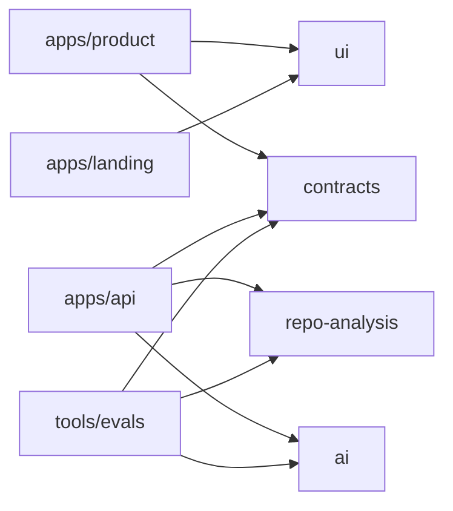
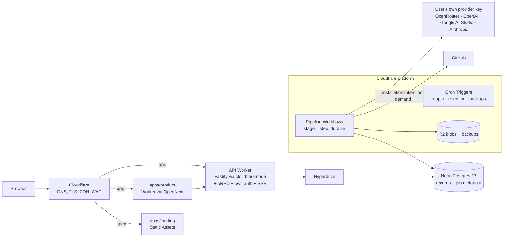

# ARCHITECTURE.md

How Replo fits together. Requirements live in [`PRD.md`](./PRD.md); research and alternatives in [`Replo_BluePrint.md`](./docs/archive/Replo_BluePrint.md) (§4–§14, §17).

## 1. Shape

**Modular monolith with separate API and worker processes**, three apps, five shared packages, one eval tool. One language (TypeScript), one deploy unit for the backend.

```
replo/
├── apps/
│   ├── landing/    Next.js 16 — static export (Cloudflare Pages): marketing, key guide, docs
│   ├── product/    Next.js 16 — the app: workspace, course player, dashboard, admin
│   └── api/        Fastify 5 + oRPC + own auth — entrypoints: main.http.ts, main.worker.ts
├── packages/
│   ├── contracts/      Zod 4 schemas + oRPC contract + error codes + course content and diagram schemas
│   ├── ai/             AI SDK wrapper, role→model resolution, provider clients (no budgets)
│   ├── repo-analysis/  filters, path safety, tree-sitter, symbols, import graph, layers, tours
│   ├── ui/             Base UI primitives, Tailwind v4 tokens, globals.css
│   └── config/         tsconfig bases, ESLint flat config (incl. boundary rules)
└── tools/evals/        golden-repo suite: index, graph, citation, diagram, course and quiz gates
```

### Dependency graph (enforced in lint)



Nothing imports an app. `contracts`, `ui`, `ai`, `repo-analysis`, `config` import no other internal package. Frontends never see `ai`, `repo-analysis` or `apps/api`.

## 2. Runtime topology



Only the **pipeline Workflows** talk to GitHub for content and model providers; blobs and backups live in R2. The product app talks only to the API. There are **no inbound webhooks** (D-114). Limits that shape this topology: 128 MB per isolate (pre-flight repo caps are the guard), 30 s CPU per HTTP request (raisable to 5 min), pipeline stages run as durable Workflows steps with no overall timeout.

### Resource shape

No fixed memory budget: Workers isolates cap at 128 MB each and scale horizontally; the pipeline is bounded by pre-flight repo caps (`MAX_REPO_FILES`, `MAX_REPO_BYTES`), per-job wall-clock/token limits, and Workflows step state living in the platform, not in memory.

## 3. Backend layout (`apps/api/src`)

```
main.http.ts        Worker fetch entry: Fastify + oRPC router + auth routes + SSE + /healthz /readyz
main.workflows.ts   pipeline Workflow class (stage = step) and instance create/cancel
main.cron.ts        scheduled: stalled sweep, retention purge, snapshot TTL, nightly backup trigger
composition.ts      builds every service from its dependencies
request-context.ts  RequestContext + Services, built per request
worker/             generate-course handler, job-payload (queue names, payload, timeouts, retry policy), error classification
platform/           config(env), db, queue, logger, crypto (key vault), errors, http guards, sse
modules/
  identity/         sign-up and sign-in, OAuth (Google, GitHub), sessions, current user
  github/           app installs, token minting, access checks (no webhooks)
  repositories/     repos, snapshots, pre-flight, import, rerun
  indexing/         orchestrates packages/repo-analysis, stores the structural graph
  jobs/             generation_jobs lifecycle: create, cancel, retry, claim, SSE progress
  pipeline/         stage handlers (ingest, index, enrich, graph-review, tours, diagrams, outline, lessons, validate, publish), checkpoints, prompts, grounding
  keys/, models/    BYOK keys, model catalogue, default model
  courses/          catalog, content, version access, publishing, workspace reads, delete
  learning/         progress, quiz attempts
  analytics/        event recording, aggregates for the dashboard
  account/, notifications/, settings/, search/, dashboard/, admin/, retention/
```

Per module: `*.service.ts` (public API) · `*.router.ts` (implements its contract slice) · `*.repo.ts` (private data access). **Modules call each other only through services.**

One course from the Generate click to the published workspace, file by file: [`docs/HOW_GENERATION_WORKS.md`](./docs/HOW_GENERATION_WORKS.md).

## 4. Contract-first API

`packages/contracts` defines inputs, outputs and typed errors. The API **implements** the contract (`implement(contract)`); the product app imports only the contract **type** (`ContractRouterClient<typeof contract>`) and builds a TanStack Query client from it. OpenAPI can be emitted from the same contract for a future public API.

```
packages/contracts ──type──▶ apps/product (client)
        └──────runtime────▶ apps/api (router implements contract; Zod validates in/out)
```

## 5. Generation pipeline

| #   | Stage                    | Kind                            | Model tier | Output                                                                                    |
| --- | ------------------------ | ------------------------------- | ---------- | ----------------------------------------------------------------------------------------- |
| 0   | Pre-flight               | Deterministic                   | —          | accept/refuse + limits                                                                    |
| 1   | Ingest                   | Deterministic                   | —          | files on disk, `snapshot_files`                                                           |
| 2   | Index (structural graph) | Deterministic (tree-sitter)     | —          | symbols, edges, routes, stack profile                                                     |
| 3   | Enrich (semantic graph)  | LLM, batched + checkpointed     | small/mid  | summaries, layers, domains, flows, concepts                                               |
| 4   | Graph review             | Deterministic + one repair pass | —          | coverage and referential-integrity report                                                 |
| 5   | Tours                    | LLM + checks                    | strong     | dependency-ordered tours with objectives and steps                                        |
| 6   | Diagrams                 | System-built + LLM + validation | mid        | `DiagramSpec[]` (architecture, tree, class, ERD, sequence, workflow, dataflow, lifecycle) |
| 7   | Outline                  | LLM + checks                    | strong     | `Outline` (chapters, objectives, prereqs) from graph/tours                                |
| 8   | Lessons + quiz           | LLM, bounded read-only tools    | mid        | chapter blocks with claim→evidence links                                                  |
| 9   | Validation & repair      | Deterministic                   | —          | validation report; ≤ 1 repair                                                             |
| 10  | Publish                  | Deterministic, one transaction  | —          | `course_versions`, `course_source_refs`, `course_lessons`, `diagram_specs`                |

`STAGES` in code: `ingest, index, enrich, graph-review, tours, diagrams, outline, lessons, validate, publish`. Critical path 2 → 3 → 5/6/7 → 8 → 9. Parallel: 3, 5, 6 and 8 under the per-job concurrency cap. **Lite path** for small repos and free models: deterministic summaries, merged enrich+outline, system-built diagrams only, ≤ 5 chapters.

### Grounding — "the model points, the system quotes"

The validator resolves `symbolKey`/anchor quotes to `(path, startLine, endLine, blobSha)` and inserts the excerpt; fabricated identifiers, nonexistent flow hops, bad diagrams and unsafe Markdown are caught deterministically. Observed claims need ≥ 1 verified ref. Every diagram node and edge must resolve to graph nodes or verified refs, and the system lays out the diagram — never the model. There is no LLM judge and no confidence score (D-113). Details: PRD §4.5.

## 6. Jobs, queue and reliability

- `generation_jobs` is the durable truth; a generation run is a **Cloudflare Workflow instance** whose steps map onto the pipeline stages. Enqueue in the **same transaction** as the job row (no dual-write); Workflow `create` rejects a second active instance per user.
- States: `queued → running → succeeded | failed | canceled`, with `waiting_retry`, `stalled`, `canceling` transitional. Workflows persist state between steps, so a resumed run skips completed stages natively — the old reaper/re-send machinery is gone.
- Per-step retry = conditional check of the job row inside `step.do`; anything but `queued|waiting_retry|stalled → running` is a no-op (duplicate delivery).
- One `AbortSignal` threads into every LLM and HTTP call; cancel flips `canceling`, terminates the Workflow instance and aborts in-flight calls between steps. No dollar budget is involved (D-116).
- Errors classified retryable (429/5xx/overloaded/timeouts) vs terminal (access revoked, too large, limit exceeded, invalid input); Workflows step retries with backoff + jitter; `retry-after` respected.
- **Triggers to add Redis/BullMQ or durable execution:** n/a — Workflows is the durable execution layer (R9). Remaining trigger: multi-tenant queue-sharding or non-TS analyzer needs.

### Progress delivery

SSE at `GET /jobs/:id/events`. Event `id = job_events.id`; reconnect replays via `Last-Event-ID`; API polls new rows ~1/s per stream (or `LISTEN/NOTIFY` on a direct connection); comment heartbeat every ~15 s; client falls back to TanStack Query polling. The active-generations page and the notification bell use the same transport.

## 7. Keys and model resolution

`packages/ai` exposes **roles**, not vendors. `modelFor({ provider, decryptedKey }, modelId)` picks the client for a job. One user-chosen model serves the course; roles may share it.

| Provider                   | Client                                                               |
| -------------------------- | -------------------------------------------------------------------- |
| `openrouter` (recommended) | OpenRouter with the user's key. `:free` models cost the user nothing |
| `openai`                   | OpenAI SDK with the user's key                                       |
| `google`                   | Google AI Studio (Gemini API) with the user's key                    |
| `anthropic`                | Anthropic SDK with the user's key                                    |

Base URLs are fixed per provider. There are no platform-owned keys, so a failing key fails the job and is never swapped for another (PRD FR-RUN-4, ADR-007).

Every call checks the job's wall-clock and token ceiling; there is no spend ledger, dollar estimate or budget (D-116). Model fallback only for retryable provider errors, and only models that passed evals.

## 8. Repository ingestion and code understanding

GitHub App (Contents + Metadata, read-only) → resolve ref to SHA → Git Trees pre-flight → one tarball per SHA → safe extraction on a `noexec` volume → deterministic index: inventory → manifests → tree-sitter (WASM) parse → module resolution → framework adapters (Next.js, React Router, Express/Fastify/Hono, stores, API call sites) → entry points → tests → docs → graph analytics. The same snapshot then gets semantic enrichment (summaries, layers, domains, flows, concepts), graph review and guided tours. **Dependencies are never installed.** Retrieval = graph expansion + lexical (BM25/trigram) + model-guided selection; embeddings are deferred (ADR-003).

A snapshot is taken once per generation. There is no commit tracking and no push subscription; a rerun takes a fresh snapshot and publishes a new course version linked to the previous one (D-114).

## 9. Data

Postgres 17 is the system of record (+ queue). Immutable, schema-versioned JSONB course documents (graph, tours, diagrams, chapters) + normalised refs/lessons/progress. Blobs addressed by git blob SHA in R2. See [`docs/DATABASE.md`](./docs/DATABASE.md).

## 10. Security architecture (summary)

Least-privilege read-only GitHub access · strict per-user scoping with cross-user CI tests · repo content is data not instructions · read-only snapshot-scoped model tools · schema-validated model output + system-inserted excerpts · envelope-encrypted BYOK keys decrypted only in the worker · non-root, read-only-FS, egress-allow-listed worker · strict CSP + allow-list Markdown · admin metadata-only access behind a server-side role gate. Full threat model: [`SECURITY.md`](./SECURITY.md).

## 11. Deployment and environments

| Environment | Where                                                                                    | Notes                                                                                         |
| ----------- | ---------------------------------------------------------------------------------------- | --------------------------------------------------------------------------------------------- |
| Local       | `docker compose` for Postgres/MinIO + `pnpm dev` on host (wrangler dev for Worker paths) | Your own key (OpenRouter recommended)                                                         |
| Preview     | Cloudflare: PR `wrangler versions upload` on `*.workers.dev` (product, api, landing)     | Neon branch per PR when DB-affecting; Playwright against the preview when product/api touched |
| Production  | Cloudflare Workers + Neon Postgres (Hyperdrive) + R2                                     | Nightly encrypted backups to R2 + Neon PITR, monthly restore drill                            |

CI/CD (GitHub Actions, everything on the same platform): PR → install frozen → `turbo run lint typecheck test build --affected` (DDL applied to a local Postgres) → eval smoke (recorded fixtures) → `wrangler versions upload` preview. Main → automatic: build → `opennextjs-cloudflare build` → `wrangler versions upload` → staged rollout (`wrangler versions deploy`, gradual traffic shift, instant rollback) after the DDL step applies new migrations to Neon. Auth via OIDC (`wrangler-action`), actions pinned to SHAs. There is no scheduled eval (D-048); an operator runs the recorded matrix before changing the allow-list.

One public origin without a custom domain: the `apps/gateway` Worker (`app.reploai.workers.dev`) fronts the other three through service bindings — `/` is the landing, `/app` is the product (Next `basePath: /app`, assets under `app/_next`), `/rpc` and `/auth` are the API, and `/healthz`/`/readyz` proxy the API probes. The internal Workers keep their own `workers.dev` hosts. Sessions stay first-party because every request reaches the browser from the gateway host, so `AUTH_COOKIE_DOMAIN` is unnecessary; `PRODUCT_URL` (with the `/app` prefix) drives redirects, `PRODUCT_ORIGIN` (bare) drives CORS and the origin guard.

Observability: pino JSON → Workers Logs, Sentry free tier, admin UI reading user/job/stage tables, alert worker on cron (failure rate > 20%/h, oldest queued > 15 min, Neon storage, backup failed, key-validation failure spike). Workers CPU limit for the api Worker raised to 5 min (`limits.cpu_ms`); pipeline stages run as Workflows steps (durable, retried, persisted state) — see R9.

## 12. When to split further

Indexing CPU/memory starves generation workers · a non-TS analyzer is required · a module needs a separate security boundary (code execution, single-tenant) · teams block each other's deploys. Until then: no microservices.
