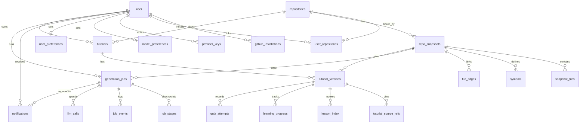

# DATABASE.md

PostgreSQL 17 is the **single system of record** (records + job queue), accessed with **Drizzle ORM 0.45.x**. Source: blueprint §6. Schema code: [`apps/api/src/platform/db/schema.ts`](../apps/api/src/platform/db/schema.ts) and `auth-schema.ts`; migrations: `apps/api/drizzle/` (generated SQL, committed, reviewed).

## Principles

- **One user owns every private row** (`user_id`). No workspaces, no roles.
- **Relational for what's queried across documents; JSONB for the document itself.** A tutorial version's full content is one immutable, schema-versioned JSONB document; refs, progress and quiz attempts are normalised.
- **Version chain:** `repository → repo_snapshot (commit SHA + analyzer_version) → tutorial_version` (pinned to exactly one snapshot, records the models used).
- **Money is integer micro-USD** (`*_micros`, 1 USD = 1,000,000). DTOs convert to USD for display only.
- **IDs:** app-side UUIDv7 for entity PKs; `user` keeps its text ID; `session` and `auth_identity` use `uuid` (`gen_random_uuid()`); `job_events` uses `bigserial`.
- **Row types never leave a module's `*.repo.ts`**; services map rows to DTOs from `@replo/contracts`.
- No vector DB, search engine or graph DB in release 1. pgvector is installed (image `pgvector/pgvector:pg17`) but unused; `chunks` is phase 2. Substring search in R1 uses the `pg_trgm` extension only (FR-SRCH-1).

## ER overview



## Tables (as implemented, plus R1 additions)

| Group               | Tables                                                                                                                                                           |
| ------------------- | ---------------------------------------------------------------------------------------------------------------------------------------------------------------- |
| Auth                | `user`, `session` (hashed token, 30 days), `auth_identity` (one row per provider per user: password hash, or a sealed GitHub token)                                                                                                                     |
| GitHub              | `github_installations`, `repositories` (global; public snapshots shared), `user_repositories` (PK user+repo, `revoked_at`)                                       |
| Models/keys         | `provider_keys` (envelope-encrypted: `ciphertext`, `iv`, `key_version`, `last4`), `model_preferences`                                                            |
| Preferences         | `user_preferences` (PK `user_id`: theme, default audience level, auto-advance, quizzes on or off, browser notifications on or off). FR-SET-1                     |
| Notifications       | `notifications` (per user: `kind`, `title`, `body`, `link`, `job_id`, `read_at`; deleted after 90 days). FR-NTF-1                                                 |
| Index               | `repo_snapshots` (unique repo+sha+analyzer; `analysis` jsonb: entry points, routes, per-file metrics), `snapshot_files`, `symbols`, `file_edges`                                                                           |
| Jobs                | `generation_jobs` (durable truth), `job_stages` (checkpoints), `job_stage_outputs` (intermediate pipeline outputs, purged on publish or by retention, D-050/D-059), `job_events` (append-only; SSE replay; 90 days), `llm_calls` (tokens, cost, latency; no prompts or completions stored; 90 days) |
| Tutorials           | `tutorials` (one per user and repository; visibility `private\|link\|public`, `share_token`, stable `slug` unique per repository; `user_id` null only after anonymising, D-031), `tutorial_versions` (JSONB `content`, `validation_report`, `generator`; `generation_job_id` unique, so a replayed publish returns the same version), `tutorial_source_refs`, `tutorial_reports` (public-tutorial reports, FR-SHR-3) |
| Search              | `lesson_index` (per version: `chapter_key`, `lesson_key`, `title`, global `position`; written at publish). `pg_trgm` GIN indexes on `repositories.name`, `tutorials.title` and `lesson_index.title` (migration `0006` creates the extension). FR-SRCH-1 |
| Learning            | `learning_progress` (PK user+version+lesson; `updated_at` orders history and resume; completion carries over by lesson key within a tutorial), `quiz_attempts` (multiple choice and true/false) |
| Webhooks            | `webhook_deliveries` (unique `source+delivery_id`), `repo_push_events` (changed paths of default-branch pushes; staleness, D-062; 90 days) |
| Operator            | `operators` (one row per operator; FR-OPS-1, D-060)                                                                                                             |
| Phase 2             | `chunks` (+ pgvector `halfvec`, GIN on `tsv`); trigram index on `symbols.name`                                                                                  |

## Budgets, not quotas

There are no platform quotas or credits (ADR-007). Each job has a budget ceiling in micro-USD (`generation_jobs.budget_micros`, with `spent_micros` updated on settle). `Budget` checks the ceiling in-process before every LLM call. If a counter is ever shared between workers, it must use atomic SQL (`UPDATE … WHERE used + $n <= limit`), never read-then-write.

## Tenancy, retention, deletion

- **Isolation:** services take the session user ID; a `scoped(userId)` helper makes the filter impossible to forget; CI cross-user tests (A requests B's IDs → 404).
- **Shared public data:** public repos' snapshots and public tutorials are global (a second import of the same commit reuses the index). Private snapshots are readable only via a non-revoked `user_repositories` link.
- **Keys:** envelope-encrypted; decrypted only in the worker, in memory, for that user's job; deletion is immediate.
- **Retention:** tarballs ≤ 24 h · private blobs only while a version/link references them · `job_events`, `llm_calls`, `notifications` 90 days · prompts/completions for private repos **not stored**.
- **Revocation/deletion:** uninstall/repo-removal webhook sets `revoked_at`, hides tutorials, schedules blob purge. Removing a repo from the library (FR-LIB-2) deletes that user's tutorials, versions and progress for it. Deleting a tutorial (FR-LIB-3) removes its versions, progress and quiz attempts. Account deletion cascades (keys, preferences, progress, private tutorials, blobs); user chooses delete vs. anonymise for public tutorials.

## Migrations workflow

```bash
pnpm infra:up           # local Postgres + MinIO
pnpm db:generate        # drizzle-kit generate → reviewable SQL in apps/api/drizzle
pnpm db:migrate         # apply (local)   — in CD: `docker compose run --rm migrate` BEFORE new code rolls out
pnpm db:check-drift     # drizzle-kit check (CI)
```

Breaking changes use **expand → backfill → contract across two deploys**. `drizzle-kit push` only against local/preview databases. Initial migration: `0000_cute_zemo.sql` (regenerated 22 Oct 2026 after the BYOK-only pivot, [ADR-007](./adr/007-byok-only-no-billing.md); **not yet applied to a live database**). Migrations `0001`–`0003` are additive. `0004` adds `job_stage_outputs`, `lesson_index`, `user_preferences` and the publish keys, `0005` adds `tutorial_reports`, `operators`, `repo_push_events` and makes `tutorials.user_id` nullable, `0006` creates the `pg_trgm` extension and the trigram indexes, `0007` adds `learning_progress.updated_at`, and `0008` drops columns nothing wrote or read (`job_stages.output_key`, `output_hash`, `started_at`, `llm_calls.cached_input_tokens`, `prompt_hash`, `repo_snapshots.artifact_key`). `0004`–`0007` are additive, so no backfill is needed. Once any database has applied `0000`, the nullable and index changes must follow expand → backfill → contract (D-015).

## Where Postgres runs

Release 1: `postgres:17`/pgvector image in Docker on the app VPS, named volume, nightly compressed + encrypted `pg_dump` to R2 (14-day retention), monthly restore drill, `shared_buffers` ≈ 512 MB on 4 GB. First managed step when downtime/backup burden hurts: Neon Launch (~$19/mo for 0.25 CU always on — pg-boss polling keeps compute awake, so the free tier doesn't fit).

## Migration order (build order)

auth → GitHub installations, repositories, user links → provider keys + model preferences + user preferences → snapshots/files/symbols/edges → jobs/stages/events/LLM calls/stage outputs → tutorials/versions/source refs/lesson index/reports → progress/quiz → notifications → operators → push events → `pg_trgm` indexes → chunks + pgvector.
