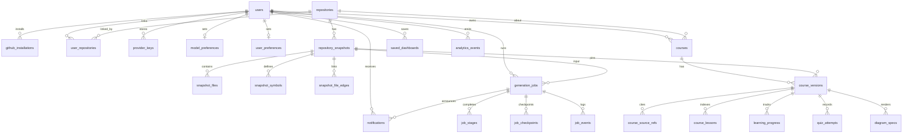

# DATABASE.md

> **Status:** R1 applied — the course rename (`0001`–`0003`) and the v2 graph, diagram, analytics, admin and removal pass (`0004`).

PostgreSQL 17 is the **single system of record** (records + job queue), accessed with **Drizzle ORM 0.45.x**. Product reads and writes live in module `*.repo.ts` files, with queue-specific SQL in `platform/queue`; services use those data access boundaries. Typed schema: [`apps/api/src/platform/db/schema.ts`](../apps/api/src/platform/db/schema.ts) and `auth-schema.ts`; canonical DDL: `apps/api/db/ddl/` (numbered SQL, committed and manually applied).

## Principles

- **One user owns every private row** (`user_id`). No workspaces, no roles.
- **Relational for what's queried across documents; JSONB for the document itself.** A course version's full content is one immutable, schema-versioned JSONB document; refs, progress and quiz attempts are normalised.
- **Version chain:** `repository → repository_snapshot (commit SHA + analyzer_version) → course_version` (pinned to exactly one snapshot, records the models used).
- **Money is integer micro-USD** (`*_micros`, 1 USD = 1,000,000). DTOs convert to USD for display only.
- **IDs:** app-side UUIDv7 for entity PKs; `users` keeps its text ID; `sessions` and `auth_identities` use `uuid` (`gen_random_uuid()`); `job_events` uses `bigserial`.
- **Row types never leave a module's `*.repo.ts`**; services map rows to DTOs from `@replo/contracts`.
- No vector DB, search engine or graph DB in release 1. pgvector is installed (image `pgvector/pgvector:pg17`) but unused; `chunks` is phase 2. Substring search in R1 uses the `pg_trgm` extension only (FR-SRCH-1).

## ER overview



## Tables (as implemented)

| Group         | Tables                                                                                                                                                                                                                                                                                                                     |
| ------------- | -------------------------------------------------------------------------------------------------------------------------------------------------------------------------------------------------------------------------------------------------------------------------------------------------------------------------- |
| Auth          | `users`, `sessions` (hashed token, 30 days), `auth_identities` (one row per provider per user: password hash, or a sealed GitHub token)                                                                                                                                                                                    |
| GitHub        | `github_installations`, `repositories` (global; public snapshots shared), `user_repositories` (PK user+repo, `revoked_at`)                                                                                                                                                                                                 |
| Models/keys   | `provider_keys` (envelope-encrypted: `ciphertext`, `iv`, `encryption_key_version`, `last4`), `model_preferences` (`default_model`)                                                                                                                                                                                         |
| Preferences   | `user_preferences` (PK `user_id`: theme, default audience level, auto-advance, quizzes on or off, browser notifications on or off). FR-SET-1                                                                                                                                                                               |
| Notifications | `notifications` (per user: `kind`, `title`, `body`, `link`, `job_id`, `read_at`; deleted after 90 days). FR-NTF-1                                                                                                                                                                                                          |
| Index         | `repository_snapshots` (unique repo+sha+analyzer; `analysis` jsonb: entry points, routes, per-file metrics), `snapshot_files`, `snapshot_symbols`, `snapshot_file_edges` (edge `kind`: `import`, `test_of`, `call`, `extends`, `implements`)                                                                                   |
| Jobs          | `generation_jobs` (durable truth), `job_stages` (one row per finished stage), `job_checkpoints` (intermediate pipeline outputs, purged on publish or by retention, D-050/D-059), `job_events` (append-only; SSE replay; 90 days)                                                                                           |
| Courses       | `courses` (one per user and repository, stable `slug` unique per repository), `course_versions` (JSONB `content`, `validation_report`, `generator`; `generation_job_id` unique, so a replayed publish returns the same version), `course_source_refs`, `course_lessons`, `diagram_specs` (typed diagram JSON + validation) |
| Search        | `course_lessons` (per version: `chapter_key`, `lesson_key`, `title`, global `position`; written at publish). `pg_trgm` GIN indexes on `repositories.name`, `courses.title` and `course_lessons.title` (the baseline DDL creates the extension). FR-SRCH-1                                                                  |
| Learning      | `learning_progress` (PK user+version+lesson; `updated_at` orders history and resume; completion carries over by lesson key within a course), `quiz_attempts` (multiple choice and true/false)                                                                                                                              |
| Dashboard     | `saved_dashboards` (name + `AnalyticsQuery` JSONB per user), `analytics_events` (append-only user events, `occurred_at`)                                                                                                                                                                                                   |
| Operator      | `operators` (one row per operator; FR-OPS-1, D-060)                                                                                                                                                                                                                                                                        |
| Phase 2       | `chunks` (+ pgvector `halfvec`, GIN on `tsv`); trigram index on `snapshot_symbols.name`                                                                                                                                                                                                                                    |

## Limits, not budgets

There are no platform quotas, credits or spend ledger (ADR-007). Each job checks a wall-clock and token ceiling in-process; there is no dollar ceiling, `job_llm_calls` row or `spent_micros` column. If a counter is ever shared between workers, it must use atomic SQL (`UPDATE … WHERE used + $n <= limit`), never read-then-write.

## Tenancy, retention, deletion

- **Isolation:** services take the session user ID; a `scoped(userId)` helper makes the filter impossible to forget; CI cross-user tests (A requests B's IDs → 404).
- **Snapshots:** a public repo's snapshot is shared (a second import of the same commit reuses the index). Private snapshots are readable only via a non-revoked `user_repositories` link.
- **Keys:** envelope-encrypted; decrypted only in the worker, in memory, for that user's job; deletion is immediate.
- **Retention:** tarballs ≤ 24 h · private blobs only while a version/link references them · `job_events`, `notifications` 90 days · expired `sessions` rows deleted daily by the retention job · prompts/completions for private repos **not stored**.
- **Preferences:** `user_preferences.theme` defaults to `system`.
- **Revocation/deletion:** uninstall or a failed access check revokes `user_repositories` lazily. Removing a repo from the library (FR-LIB-2) deletes that user's courses, versions and progress for it. Deleting a course (FR-LIB-3) removes its versions, progress and quiz attempts. Account deletion cascades keys, links, snapshots, jobs, courses, progress and blobs.

## Naming

- Tables are plural `snake_case`. A child table carries its parent's name as a prefix: `repository_snapshots`, `snapshot_files`, `snapshot_symbols`, `snapshot_file_edges`; `job_stages`, `job_checkpoints`, `job_events`; `course_versions`, `course_lessons`, `course_source_refs`.
- `generation_jobs` keeps its long name so it is never confused with pg-boss's own `pgboss.job` table. Its children use the short `job_` prefix.
- A foreign key says what it points at: `provider_key_id`, `github_installation_id`, `reporter_user_id`. The one exception is `user_id`, which always means the owning user.
- Timestamps end in `_at` and say what happened: `created_at`, `answered_at`, `finished_at`. No bare `at`.
- `courses.current_version_id` references `course_versions(id)` and is set to null if that version is deleted.

## Schema change workflow

```bash
pnpm infra:up           # local Postgres + MinIO
pnpm db:setup           # reset target public schema, then apply apps/api/db/ddl/*.sql
```

`0000_baseline.sql` creates the complete application schema as it stood before the course rename. `0001_expand_courses.sql` renames the tables and adds `course_id` beside `tutorial_id` (keeping the old names as views); `0002_backfill_courses.sql` copies every id and makes the new columns non-null; `0003_contract_courses.sql` drops the old columns and views and renames the remaining indexes and constraints. `0004_schema_v2.sql` drops the webhook, report, spend/ledger and visibility storage and adds `diagram_specs`, `saved_dashboards`, `analytics_events`, `repository_snapshots.graph` and `users.role`. `pnpm db:setup` is a destructive development reset: it drops and recreates the `public` schema in the Compose `postgres` service's `app/replo` database, then applies every numbered DDL file in order. It does not drop other databases on the server. For a change, update the matching Drizzle table definitions, add the next numbered SQL file with only that change, and execute that new file manually on each existing database. Keep the SQL file committed so new contributors can reset and bootstrap the full current schema with `pnpm db:setup`. For destructive or multi-release changes, use expand → backfill → contract and document operational steps here.

Breaking changes use **expand → backfill → contract across two deploys** (D-015).

## Where Postgres runs

Release 1: `postgres:17`/pgvector image in Docker on the app VPS, named volume, nightly compressed + encrypted `pg_dump` to R2 (14-day retention), monthly restore drill, `shared_buffers` ≈ 512 MB on 4 GB. First managed step when downtime/backup burden hurts: Neon Launch (~$19/mo for 0.25 CU always on — pg-boss polling keeps compute awake, so the free tier doesn't fit).

## Migration order (build order)

auth → GitHub installations, repositories, user links → provider keys + model preferences + user preferences → snapshots/files/symbols/edges → jobs/stages/checkpoints/events → courses/versions/source refs/lessons + diagram specs (rename `0001`–`0003`, v2 `0004`) → progress/quiz → notifications → saved dashboards/analytics → `pg_trgm` indexes → chunks + pgvector.
